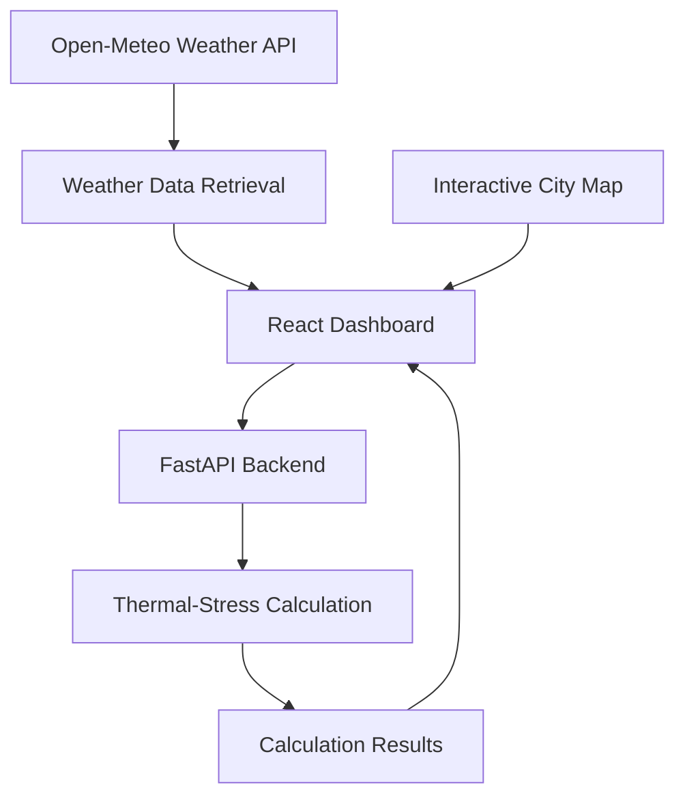

# THERMOCORTEX
### Extreme Heatwave Early Warning & Human Thermal Stress Intelligence Platform

**Beyond temperature. Toward contextual heat-risk awareness.**

THERMOCORTEX explores how weather conditions and thermal-stress calculations can be combined to provide a more contextual understanding of extreme heat. Developed by **Team GIT SHIP DONE** for Smart India Hackathon 2026, the project brings environmental data, geographic visualization, and thermal-stress analysis into a unified dashboard.

<p align="center">
  
  
  
  
  
  
</p>

---

## The Problem

Extreme heat is not defined by air temperature alone. Relative humidity, wind conditions, and solar exposure influence how the human body experiences hot environments.

Two locations with the same air temperature can present different thermal conditions. Yet, temperature-focused displays may not communicate these differences clearly.

The challenge is to bring relevant environmental variables together and present them in a way that makes heat conditions easier to explore and interpret.

## Our Approach

THERMOCORTEX combines weather data, backend thermal-stress calculations, and interactive geographic visualization in one application.

The current prototype allows users to explore supported cities, view their available weather conditions, and examine illustrative thermal-stress results. Its modular architecture provides a foundation for developing more transparent regional estimates and evaluating different thermal-stress methodologies.

## Application Preview

The following sections are reserved for screenshots of the actual running prototype.

 **Main Dashboard**<br><br>(https://github.com/prachi01645/thermocortex.SIH/blob/main/docs/images/dashboard.png) (https://github.com/prachi01645/thermocortex.SIH/raw/main/docs/images/dashboard.png))<br>Weather information and thermal-stress results in one interface.
 **Interactive Map**<br><br>\
|---|---|
| **Forecast Timeline**<br><br>[THERMOCORTEX forecast timeline](https://github.com/prachi01645/thermocortex.SIH/blob/main/docs/images/forecast-timeline.png) 
<br>Explore available hourly weather conditions and forecast variables. 
| **Thermal-Stress Analysis**<br><br>[THERMOCORTEX thermal-stress analysis](https://github.com/prachi01645/thermocortex.SIH/blob/main/docs/images/thermal-stress.png) ([image](https://github.com/prachi01645/thermocortex.SIH/raw/main/docs/images/thermal-stress.png))<br>Explore thermal-stress calculations and illustrative sun-versus-shade scenarios. |
| **Response Priorities**<br><br>[THERMOCORTEX response priorities](https://github.com/prachi01645/thermocortex.SIH/blob/main/docs/images/response-priorities.png) ([image](https://github.com/prachi01645/thermocortex.SIH/raw/main/docs/images/response-priorities.png))<br>View precautionary guidance for hot conditions. | **Regional Overview**<br><br>[THERMOCORTEX regional overview](https://github.com/prachi01645/thermocortex.SIH/blob/main/docs/images/regional-overview.png) ([image](https://github.com/prachi01645/thermocortex.SIH/raw/main/docs/images/regional-overview.png))<br>Compare the prototype's regional demonstration scores. |
| **Methodology & Data Sources**<br><br>[THERMOCORTEX methodology and data](https://github.com/prachi01645/thermocortex.SIH/blob/main/docs/images/method-data.png) ([image](https://github.com/prachi01645/thermocortex.SIH/raw/main/docs/images/method-data.png))<br>Review weather sources, calculation assumptions, limitations, and validation plans. | |


## Core Capabilities

- **Weather data integration:** Retrieves available current and hourly weather variables from Open-Meteo.
- **Interactive geographic visualization:** Supports map-based selection of four Indian cities.
- **Thermal-stress calculations:** Uses a Python backend and `pythermalcomfort` to calculate thermal-stress indicators.
- **Exposure comparison:** Presents illustrative open-sun and shade scenarios based on the current assumptions.
- **Connected architecture:** Integrates a React dashboard with a FastAPI backend for calculation requests.
- **Periodic updates:** Refreshes weather information for the currently selected city.

## System Architecture



The frontend manages the dashboard and city-selection experience, while the backend handles thermal-stress calculations. Weather information comes from an external API, keeping data retrieval separate from calculation logic.

## Technology Stack

| Layer | Technologies |
|---|---|
| Frontend | React, Vite, JavaScript, CSS |
| Backend | Python, FastAPI |
| Thermal calculations | pythermalcomfort |
| Weather data | Open-Meteo API |
| Mapping | React Leaflet, ArcGIS World Street Map |
| Version control | Git, GitHub |

## Getting Started

### Prerequisites

Python 3.10 or newer, Node.js, npm, and Git.

**1. Clone the repository**

```bash
git clone https://github.com/prachi01645/thermocortex.SIH.git
cd thermocortex.SIH
```

**2. Start the backend**

```bash
cd backend
py -m pip install fastapi uvicorn pythermalcomfort astral
py -m uvicorn main:app --reload
```

The backend should run at `http://127.0.0.1:8000`.

**3. Start the frontend**

Open a second terminal in the project root:

```bash
npm install
npm run dev
```

Open the local URL displayed by Vite, usually `http://localhost:5173`.

Additional Python dependencies may be required if they are not included in the commands above.

## Current Status and Future Direction

The prototype includes the React dashboard, selected-city weather integration, interactive map, and initial backend thermal-stress calculations.

The next development priorities are to replace fixed regional demonstration scores with transparent weather-based estimates, document the selected methodology and its assumptions, test calculations against appropriate reference data, and explore integration with official heat-alert sources.

These improvements are necessary before the system can be considered for operational heat-risk assessment.

## Limitations

THERMOCORTEX is an experimental prototype, not an official heatwave-warning service. Its thermal-stress results rely on model inputs and assumptions and have not been independently validated. The open-sun and shade comparison is illustrative, and fixed regional demonstration scores must not be interpreted as validated risk rankings.

For real-world safety decisions, consult official meteorological alerts and public-health guidance.

## Team

**GIT SHIP DONE**  
Smart India Hackathon 2026

## License

Distributed under the MIT License. See [LICENSE](LICENSE) for details.
